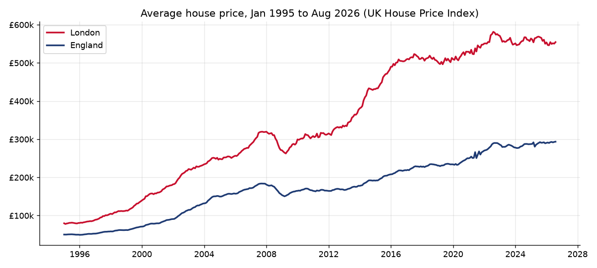
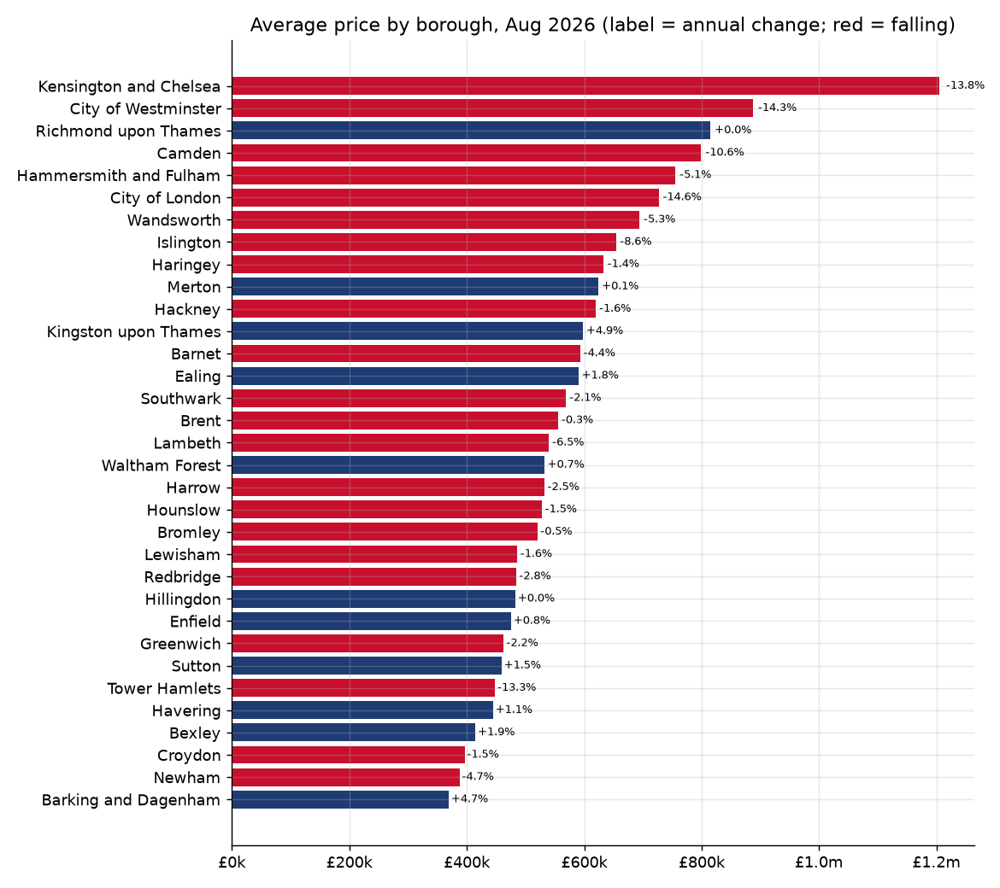
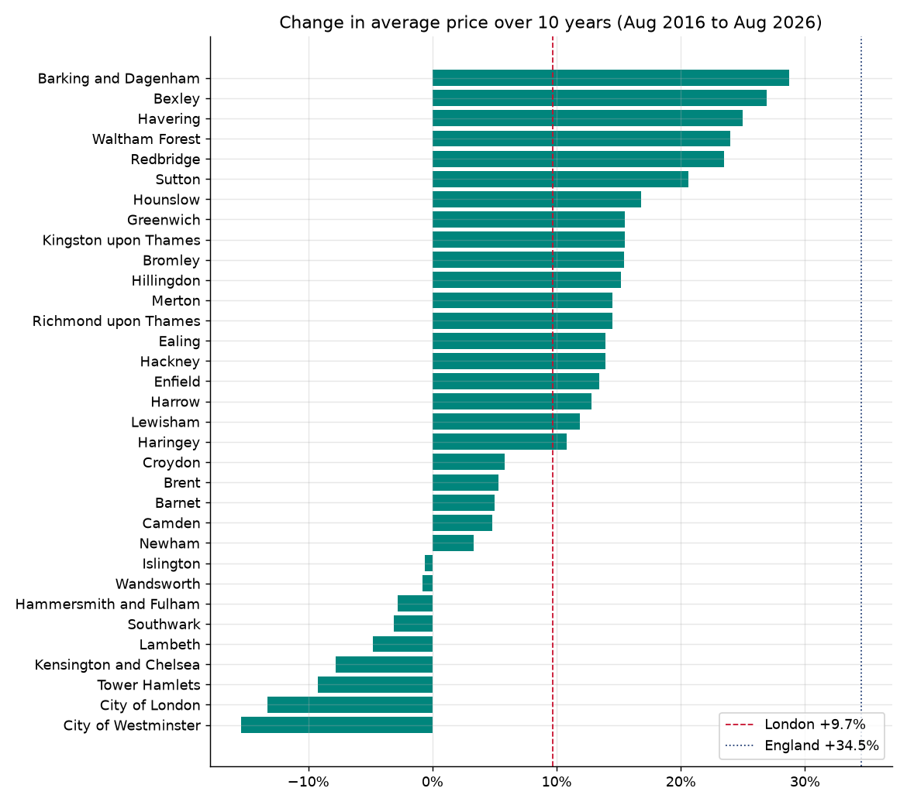
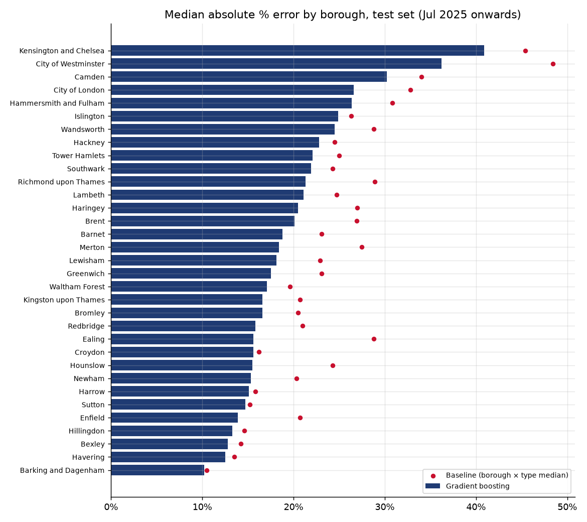
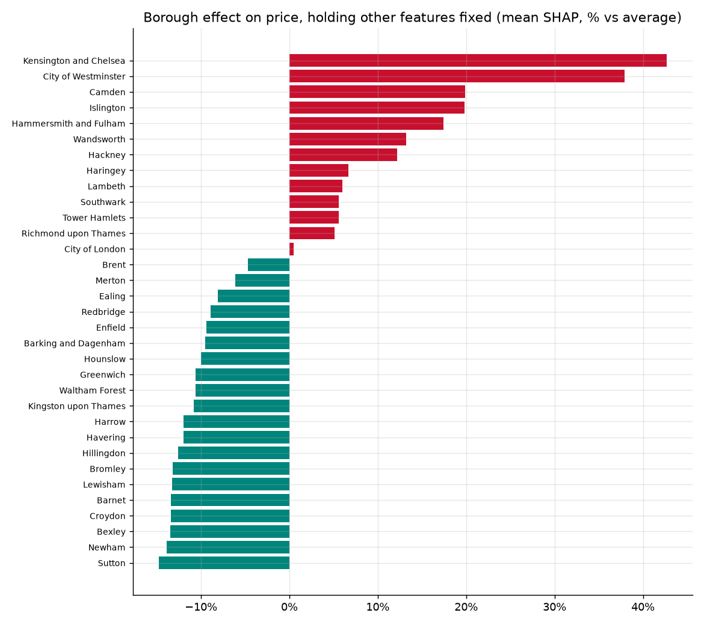
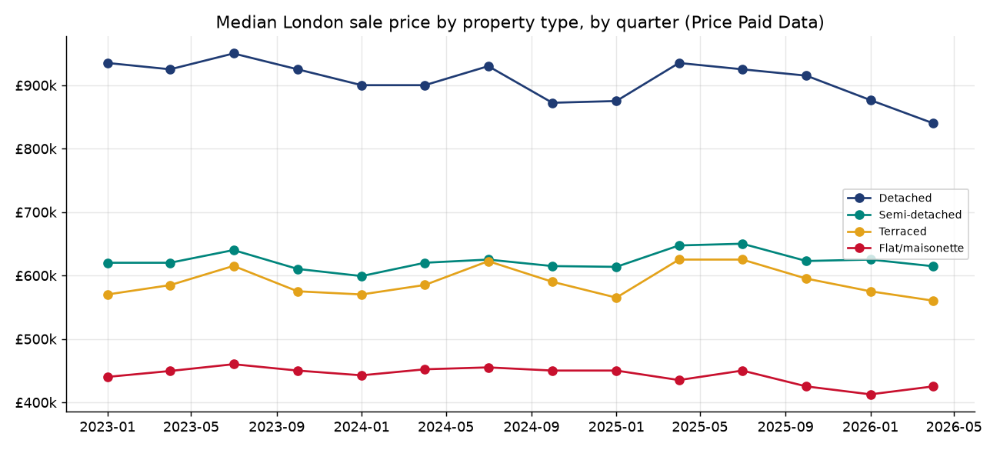
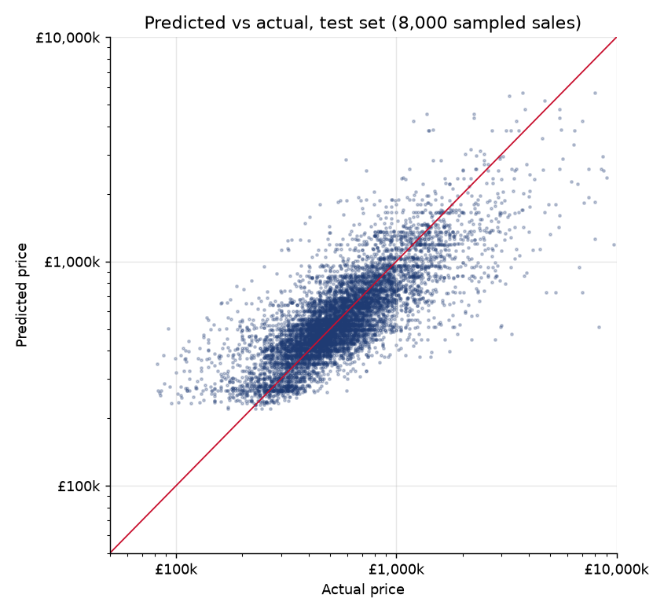
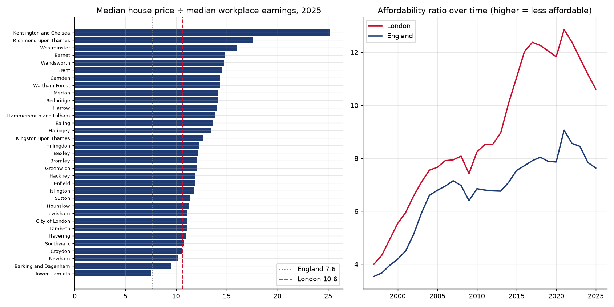
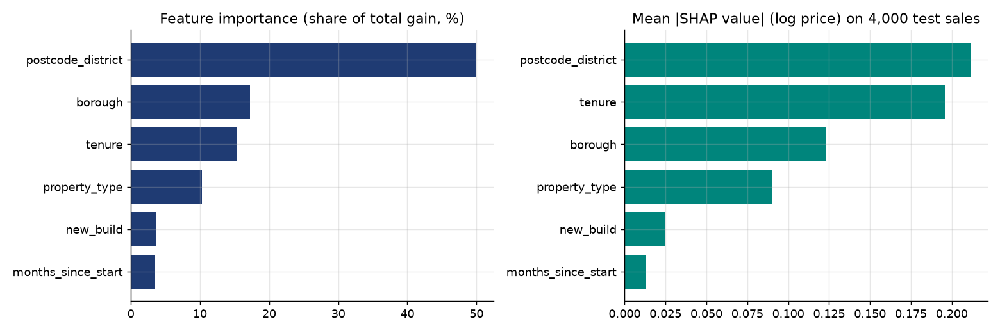
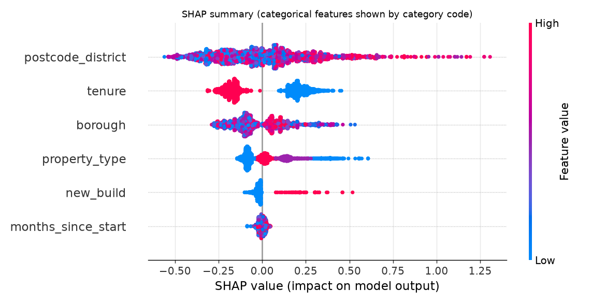

# London house prices: borough trends, affordability and a gradient-boosted price model

An end-to-end look at the London housing market built from official open data. It covers 30 years of borough-level
prices from the UK House Price Index, ONS affordability ratios, and 279,208 individual London sales from HM Land
Registry Price Paid Data (January 2023 to August 2026). These sales are used to train a LightGBM price model with a
time-based train/test split, SHAP explanations and an error breakdown by borough. A Streamlit app lets you explore
the trends and estimate a sale price.

Author: Anthony Adusei-Poku ([@anthony07-max](https://github.com/anthony07-max))



## Key findings

**Market trends (UK HPI, August 2026)**
1. **London's average price is £554,430, down 2.2% on a year earlier and 4.6% below its August 2022 peak**
   (£581,320). England is up 0.4% at £293,525. London is still 88.9% more expensive than England overall.
2. **Over the last 10 years London has badly lagged the rest of England:** +9.7% compared with +34.5% for England
   (August 2016 to August 2026, nominal). Prices have still risen 6.96 times since January 1995.
3. **Prime central London has fallen furthest.** Kensington & Chelsea (−13.8% year on year, −27.3% from its peak) and
   Westminster (−14.3% year on year, −27.6% from its peak) lead the declines. Westminster is 15.4% lower than 10 years
   ago. Prices are falling year on year in **22 of 33 boroughs**, and 9 boroughs are 10% or more below their peak.
4. **The cheaper outer east has done best.** Barking & Dagenham (£369,881, the cheapest borough) has risen 28.7% in
   10 years, followed by Bexley (+26.9%) and Havering (+25.0%). Kensington & Chelsea (£1.20m) costs 3.3 times as much
   as Barking & Dagenham.

**Affordability (ONS, 2025)**

5. **A typical London home costs 10.6 times typical London workplace earnings**, compared with 7.6 for England. In 1997
   it was 4.0. The ratio peaked at 12.9 in 2021 and has improved each year since as earnings outpaced prices.
   Kensington & Chelsea is the least affordable borough (25.2). Tower Hamlets is the most affordable (7.5) because of
   its high workplace earnings (Canary Wharf). 31 of 33 boroughs are above 10.

**Transactions (Price Paid Data)**

6. The median London sale in 2025 was **£530,000** (85,879 standard sales). Flats made up 51.7% of sales (median
   £443,000), against £594,220 for terraced, £625,000 for semi-detached and £910,000 for detached homes.
   New-build flats sold at a 36.6% higher median price than resale flats in 2024-25.

**Price model (test set: 74,788 sales from July 2025 to August 2026, never seen in training)**

7. **The gradient-boosting model gets a median absolute error of 18.2%** (median £95,498), compared with 22.3% for a
   borough × property-type median baseline. Its R² on log price is 0.632 against 0.503 for the baseline. 53.7% of
   predictions fall within 20% of the actual price, and the model beats the baseline in **all 33 boroughs**.
8. **Location dominates.** Postcode district accounts for 50.0% of the model's total gain and borough for another 17.2%,
   followed by tenure (15.4%) and property type (10.3%). Holding other features fixed, the mean SHAP effect is +42.7%
   for Kensington & Chelsea and −14.8% for Sutton. A new build adds about 28.8% compared with a resale, and leasehold
   takes about 16.3% off the average prediction.
9. **Errors are smallest where homes are similar to each other and largest in prime central London.** The median
   error ranges from 10.2% in Barking & Dagenham to 40.9% in Kensington & Chelsea. Semi-detached and terraced homes
   (about 15%) are easier to price than flats and detached homes (about 21-22%).

| | |
|---|---|
|  |  |
|  |  |
|  |  |





## Method
- **Price Paid Data:** the yearly files for 2023 to 2026 (year to date) are streamed and only Greater London rows are
  kept. House numbers and street names are dropped at download. Only **category A** sales are modelled (standard
  market-value sales, which excludes repossessions, buy-to-lets bought by companies and other transfers). The
  property types kept are detached, semi-detached, terraced and flat/maisonette ("other" is excluded). Six sales under
  £25,000 are removed as nominal prices.
- **Features:** property type, tenure, new build, borough, postcode district (outward code, such as `SE15`) and sale
  date (months since January 2023). The target is log price.
- **Split:** this is a time-based split, not a random one. The model trains on January 2023 to June 2025 (204,414
  sales) and is tested on July 2025 to August 2026 (74,788 sales). The last three training months are held back to
  choose the number of boosting rounds with early stopping (164). The model is then refitted on the whole training
  period.
- **Model:** LightGBM with native categorical handling and an L1 objective on log price, so it is robust to extreme
  prices. The baseline is the training-period median price for the same borough and property type.
- **Explainability:** feature importance by gain, and SHAP values (TreeExplainer) on a sample of 4,000 test sales.
  Borough and category effects are mean SHAP values, converted from log points to a % effect against the model's
  average prediction.
- **Trends and affordability:** monthly UK HPI average prices for the 33 London local authorities, London and
  England. Affordability is the ONS ratio of median house price to median gross annual **workplace-based** earnings
  (table 5c, local authorities, and table 1c, regions).

## Data sources
- **HM Land Registry, [Price Paid Data](https://www.gov.uk/government/statistical-data-sets/price-paid-data-downloads)**,
  yearly files 2023 to 2026. Contains HM Land Registry data © Crown copyright and database right 2026. This data is
  licensed under the [Open Government Licence v3.0](https://www.nationalarchives.gov.uk/doc/open-government-licence/version/3/).
  Address fields are not republished here.
- **HM Land Registry, [UK House Price Index](https://www.gov.uk/government/collections/uk-house-price-index-reports)**,
  full file for August 2026 (published 21 October 2026). Open Government Licence v3.0.
- **Office for National Statistics, [House price to workplace-based earnings ratio](https://www.ons.gov.uk/peoplepopulationandcommunity/housing/datasets/ratioofhousepricetoworkplacebasedearningslowerquartileandmedian)**,
  released 26 March 2026 (data to 2025). Open Government Licence v3.0.

## Project structure
```
src/download.py      # streams Price Paid Data (London only), UK HPI full file, ONS affordability workbook into data/raw/
src/clean.py         # builds the modelling table (data/interim/, not committed) and tidy HPI / affordability tables
src/analysis.py      # borough trends, affordability, transaction summaries, charts 01-05
src/model.py         # LightGBM model, baseline, SHAP, error by borough, charts 06-10, models/
app/streamlit_app.py # explorer and price estimator
models/              # trained LightGBM model and metadata used by the app
charts/              # PNG outputs
data/processed/      # summary CSVs and JSON findings
```

## How to run
```bash
python -m venv .venv && source .venv/bin/activate
pip install -r requirements.txt
./run_pipeline.sh                      # download (~550 MB streamed, ~40 MB kept), clean, analyse, train (~3 minutes)
streamlit run app/streamlit_app.py     # app at http://localhost:8501
```

## Limitations
- **The model has no information about the size or condition of a home** (floor area, bedrooms, garden,
  refurbishment), because Price Paid Data does not record them. This is why errors are high for flats and prime
  central London, where homes in the same postcode district vary enormously. Matching to EPC floor-area data would be
  the obvious next step.
- Sale date enters as a trend term, and tree models cannot extrapolate a trend. Predictions for future dates
  effectively assume prices stay at the level of the latest training data.
- Price Paid Data records a sale when it is registered, which can be weeks or months after completion. The latest
  months (especially August 2026) are incomplete. UK HPI figures for recent months are also provisional and get revised.
- Category B sales (repossessions, company purchases, transfers under a power of sale) are excluded, so the model
  describes ordinary market sales only.
- Affordability ratios use **workplace-based** earnings (where people work, not where they live). This flatters
  boroughs with large employment centres such as Tower Hamlets and the City of London.
- All prices are nominal. The 10-year changes are not adjusted for inflation.
